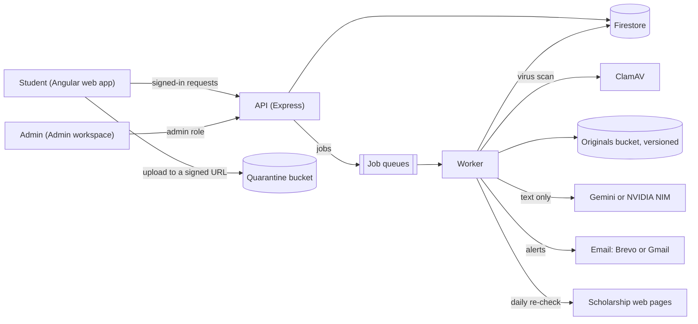
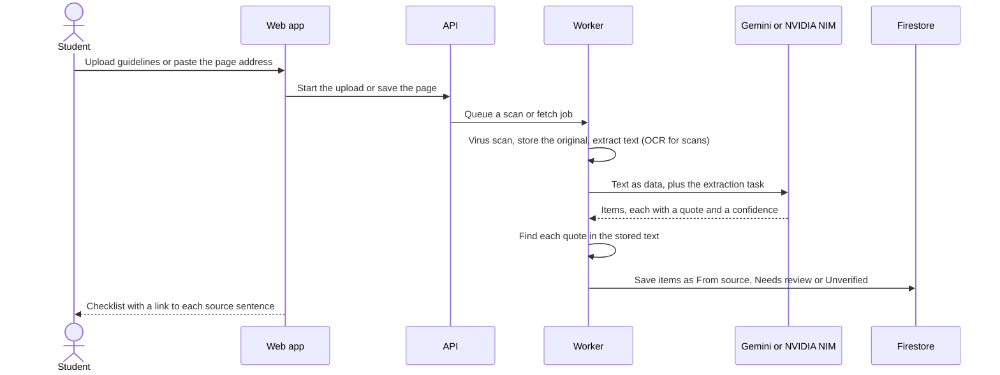

<div align="center">

# ScholarScope

**No source, no claim.**

A scholarship tracker that ties every requirement to the exact sentence it came from, so students never miss a rule, a document or a changed deadline.

_Mentor Me Collective (MMC) BUILD, Fall 2026 · Google Cloud Launchpad Showcase · Team ScholarScope_

[](https://github.com/sarah-chowdhury4/scholar-scope/actions/workflows/ci.yml)
[](https://angular.dev/)
[](https://nodejs.org/)
[](https://firebase.google.com/)
[](https://ai.google.dev/)
[](https://build.nvidia.com/)
[](infra/README.md)
[](#14-testing-and-quality-assurance)
[](https://sdgs.un.org/goals/goal4)

</div>

---

## Submission Links

| **Deliverable** | **Link** |
|---|---|
| Presentation deck | [ScholarScope-Presentation.pptx](docs/deliverables/ScholarScope-Presentation.pptx) |
| Written summary | [ScholarScope-Written-Summary.pdf](docs/deliverables/ScholarScope-Written-Summary.pdf) |
| Recorded walkthrough | [Watch on YouTube](https://youtu.be/PK8dkiaQhP4) |
| Local setup guide | [docs/SETUP.md](docs/SETUP.md) |
| Team dataset | [Dataset/](Dataset/) · [Data documentation](dataset_documentation.md) |
| Architecture diagram | [architecture-diagram.jfif](architecture-diagram.jfif) |
| Samples for testing | [samples/](samples/README.md) |

[](https://youtu.be/PK8dkiaQhP4)

---

## Table of Contents

1. [Target Audience](#1-target-audience)
2. [Problem Statement](#2-problem-statement)
3. [UN Sustainable Development Goal](#3-un-sustainable-development-goal)
4. [Solution Overview](#4-solution-overview)
5. [Key Features](#5-key-features)
6. [User Journey](#6-user-journey)
7. [System Architecture](#7-system-architecture)
8. [Google Cloud Integration](#8-google-cloud-integration)
9. [NVIDIA Integration](#9-nvidia-integration)
10. [Verification Rules](#10-verification-rules)
11. [Technology Stack](#11-technology-stack)
12. [Setup and Run Instructions](#12-setup-and-run-instructions)
13. [Data Sources and Sample Data](#13-data-sources-and-sample-data)
14. [Testing and Quality Assurance](#14-testing-and-quality-assurance)
15. [Demo](#15-demo)
16. [Privacy, Security, and Responsible Use](#16-privacy-security-and-responsible-use)
17. [Limitations and Future Scope](#17-limitations-and-future-scope)
18. [Team Credits and Individual Contributions](#18-team-credits-and-individual-contributions)
19. [Documentation Hub](#19-documentation-hub)
20. [License](#20-license)

---

## 1. Target Audience

ScholarScope is built for students applying for several scholarships at once, who need to know exactly what each one asks for:

- **Low-income and first-generation students**, often applying without help at home and with an overloaded school counselor.
- **High school seniors and college applicants** juggling different deadlines, essay prompts and document rules.
- **Students applying abroad**, where deadlines are in another time zone and rules include citizenship or language requirements.
- **Scholarship programs and advisers** who want students to read the official rules, not a summary of them.

Our persona, **Jay Clark**, is an 18-year-old first-generation student with a 3.40 GPA who wants to study computer science without taking on debt, and tracks applications on sticky notes.

---

## 2. Problem Statement

Scholarship criteria, essay prompts and deadlines change, and one missed change can disqualify an application. Students face:

- Requirements spread across a main page, eligibility pages, FAQs and PDFs.
- Deadlines that move, or are stated in another time zone.
- Documents (transcripts, certificates, passports) that must match each scholarship's rules: the right kind of file, the right name, a minimum GPA, not expired.
- AI summaries and third-party lists that state requirements without showing where they came from, so a student can't tell whether they are right.

---

## 3. UN Sustainable Development Goal

**SDG 4: Quality Education.**

By simplifying the administrative work of applying and keeping every requirement accurate and traceable, ScholarScope lowers a barrier to financial aid for underserved students, so a missed rule or deadline doesn't cost them an award they qualify for.

---

## 4. Solution Overview

ScholarScope reads a scholarship's official guidelines (an uploaded file or its web page) and turns them into a checklist. **Every item must quote the sentence it came from**, and the quote is checked against the stored source. The student reviews each item, keeps track of documents and deadlines, and is alerted when the guidelines change.

**Design principles**

- **No source, no claim:** a requirement is only shown as From source when its quote is found, character for character, in the stored guidelines. Anything else is Unverified.
- **The student decides:** every item can be confirmed, corrected or rejected, and corrections are saved as new versions, never overwritten.
- **Untrusted inputs:** uploads, web pages and AI output are all treated as untrusted. Uploads are virus-scanned, and document text is passed to the AI as data, never as instructions.
- **Honest drafts:** essay drafts use only the student's own notes, and any sentence not based on them is marked.

---

## 5. Key Features

- **Discover catalog.** Search and filter the team's 15 checked scholarships by deadline, GPA, provider or what the application asks for, or add one that isn't listed.
- **Guidelines with citations.** Upload a PDF, Word file, image or text file, or save the scholarship's web page. ScholarScope also reads linked rule pages (eligibility, FAQ). Each requirement links to the exact sentence in the source.
- **Review and versions.** Confirm, correct or reject each item, tick items off, and see every version in History.
- **Change detection.** A daily re-check of saved pages shows the old and new wording side by side, with an AI summary, and sends an alert.
- **Deadline alerts.** Email and in-app reminders 14, 7, 3 and 1 days before and on the day (adjustable by admins), shown in the student's own time zone.
- **Document library and AI checks.** Transcripts, certificates and passports are virus-scanned, then checked against each scholarship: right kind of file, name versus profile, expiry versus deadline, GPA at the right school level, official or English rules.
- **Essay drafts.** Drafts written only from the student's notes, with unsupported sentences marked and a note when a draft is short because the notes are short.
- **Readiness and exports.** A readiness bar per scholarship, a calendar file (.ics), a CSV checklist and a print view.
- **Admin workspace.** Catalog management, settings (AI switch, reminder days, limits), accounts and an audit log, for staff accounts only.
- **Delete my data.** Students can request permanent erasure of their account and files.

---

## 6. User Journey

```text
1. Discover
   Find a scholarship in the catalog, or add your own.
        |
        v
2. Add the guidelines
   Upload a file or paste the scholarship's web page.
   The file is virus-scanned and stored; scans are read with OCR.
        |
        v
3. Extract and check
   The AI lists deadlines, essays, eligibility rules and documents,
   each with a quote. Quotes are checked against the stored text:
   From source / Needs review / Unverified.
        |
        v
4. Review and prepare
   - Confirm, correct or reject each item
   - Check documents from your library against the rules
   - Draft essays from your own notes
   - Track readiness and export the calendar or checklist
        |
        v
5. Stay up to date
   Daily page re-checks flag changes side by side, and reminders
   go out before each deadline.
```

---

## 7. System Architecture



The web app talks only to the API, which checks the sign-in token on every request. Slow work (virus scans, OCR, AI extraction, document checks, essay drafts, page re-checks, emails) runs as queued jobs in a separate worker. Only the worker holds API keys and sends email.

### Data flow: reading a scholarship's guidelines



---

## 8. Google Cloud Integration

- **Firebase (Google).** Firebase Authentication for sign-in and Firestore for all app data. Locally they run as the Firebase emulators.
- **Gemini.** With `AI_PROVIDER=gemini` or `auto`, Gemini reads requirements, checks documents, summarises changes and drafts essays, through the Gemini API (Google AI Studio). It also searches the web with Google Search to find a scholarship's official rule pages when the saved page is thin.
- **Google Cloud infrastructure as code.** The production setup is written in Terraform in [`infra/`](infra/README.md): Firestore, Cloud Storage buckets, Cloud Tasks queues, Secret Manager, Cloud Run (API, worker with a ClamAV sidecar, deleter job), Cloud Scheduler and Artifact Registry. In the cloud, Gemini runs on **Vertex AI** with the worker's own identity, so no Gemini key is needed.
- **Checked without a cloud account.** `npm run infra:check` runs terraform fmt and validate, tfsec, checkov and infracost in Docker, locally and in CI.

Each Google Cloud service has a local stand-in behind a small adapter in `shared/src/platform/`, chosen by environment variables:

| Production service (Google Cloud) | Local stand-in |
|---|---|
| Firestore, Identity Platform | Firebase emulators |
| Cloud Storage | MinIO (Chainguard build) |
| Cloud Tasks, Secret Manager | LocalStack SQS and Secrets Manager |
| Malware scanning | ClamAV |
| Cloud Vision OCR | Tesseract inside the worker |
| Vertex AI Gemini | Gemini API (Google AI Studio free tier) |
| Cloud Scheduler | `node-cron` inside the worker |

The Terraform has not been applied: the Google Cloud adapters for storage and queues are still stubs, so a hosted deployment is future work.

---

## 9. NVIDIA Integration

ScholarScope uses **NVIDIA NIM's hosted API** with the **Nemotron 3.5** models:

- **Accuracy jobs:** `nvidia/nemotron-3.5-super-vl-120b-a12b` reads requirements, checks documents, summarises changes and drafts essays when `AI_PROVIDER=nim` (NVIDIA only) or `auto` (Gemini first, NIM when Gemini is busy or out of quota).
- **Same safeguards for every provider:** the same prompts, JSON schema and quote check apply whichever AI answers, and each result records the model that produced it.
- **The demo video was recorded with `AI_PROVIDER=nim`.**

The model can be changed in `.env` (`NIM_JSON_MODEL`) without a code change; the defaults are in `shared/src/platform/ai/nim.ts`.

---

## 10. Verification Rules

**Requirement status**

| Status | When |
|---|---|
| **From source** | The quote is found in the stored source, and the AI's confidence is at least **85%** |
| **Needs review** | The quote is found, but confidence is below 85% |
| **Unverified** | The quote can't be found in the source, or the student typed the value by hand |

Catalog scholarships are **From source** when the team checked them against the official page (a source URL and a status that isn't Unverified).

**Document checks**

| Check | Result |
|---|---|
| Kind of file | Warns when a file doesn't look like the document it was saved as (for example a timetable saved as a transcript) |
| Name | Compares the name on the document with the student's profile |
| Expiry | Compares a passport's expiry date with the scholarship deadline |
| GPA | Compares the GPA on the transcript of the matching school level with the scholarship's minimum, and warns about different grading scales |
| Official / English | Flags unofficial copies and documents not in English when a scholarship requires them |

Every fact a rule uses must quote the document first. The AI never reads out passport or ID numbers.

---

## 11. Technology Stack

| Domain | Technology | Purpose |
|---|---|---|
| Frontend | Angular 22 (signals, standalone components) | Student and admin web app |
| API | Node.js 22, Express 5 | Sign-in check, validation, routes |
| Background jobs | Node.js worker with queues | Scans, OCR, AI jobs, re-checks, alerts, email |
| Auth and database | Firebase Authentication, Firestore | Accounts, custom admin role, app data |
| File storage | Cloud Storage (MinIO locally) | Quarantine, versioned originals, exports |
| Queues and secrets | Cloud Tasks, Secret Manager (LocalStack locally) | Job queues, API keys |
| Virus scanning | ClamAV | Every upload, before anything reads it |
| OCR | Tesseract | Scanned PDFs and images |
| AI | Gemini, NVIDIA NIM (Nemotron 3.5) | Extraction, document checks, change summaries, drafts |
| Web pages | Jina Reader, direct fetch | Reading saved scholarship pages |
| Email | Brevo or Gmail (Mailpit locally) | Codes, deadline and change alerts |
| Infrastructure | Terraform, Docker Compose | Google Cloud setup, local stack |
| Testing and CI | Vitest, Angular tests, GitHub Actions, gitleaks | Tests and checks on every pull request |

---

## 12. Setup and Run Instructions

### Prerequisites

- Docker with Compose v2 and at least 6 GB of memory
- Node.js 22.22.3 or newer
- Git
- Free keys: a LocalStack auth token, and a Gemini API key and/or an NVIDIA API key

### Run locally

The first setup takes about 30–45 minutes and is described step by step for Windows, macOS and Linux in **[docs/SETUP.md](docs/SETUP.md)**. After that:

```bash
npm start   # starts everything and waits until the site answers
npm stop    # saves accounts and data, then stops
```

Open <http://localhost:4200>.

### Choose the AI

`AI_PROVIDER` in `.env`:

| Value | What it does |
|---|---|
| `gemini` (default) | Gemini only. Needs `GEMINI_API_KEY`. |
| `nim` | NVIDIA NIM only. Needs `NVIDIA_API_KEY`. The Google Search for official pages is skipped. |
| `auto` | Gemini first; NIM answers when Gemini is busy or out of quota. Needs both keys. |

Keys go only in `.env.secrets`. Never commit API keys, real student documents or personal data.

---

## 13. Data Sources and Sample Data

- **Scholarship catalog:** the team's dataset of **15 scholarships** (domestic awards and international study grants), each with a deadline, minimum GPA, required materials and a verified source URL. See [Dataset/](Dataset/) and [dataset_documentation.md](dataset_documentation.md).
- **Sample documents:** 9 fictional transcripts and look-alike files for testing document checks, each watermarked SAMPLE. See [samples/README.md](samples/README.md).
- **Sample scholarship site:** a fictional scholarship website for testing page reading and change alerts. See [samples/scholarship-site/README.md](samples/scholarship-site/README.md).

All test data is fictional. Free AI tiers may keep what they are sent, so real student records are never used.

---

## 14. Testing and Quality Assurance

All **219 unit tests** (shared code, API, worker) and **48 Angular tests** pass.

```bash
npm run check                               # typecheck + unit tests
cd web && npx ng test --watch=false         # Angular tests
npm run infra:check                         # Terraform: fmt, validate, tfsec, checkov
docker compose run --rm --entrypoint /bin/sh minio-init /init/test-permissions.sh   # storage permissions
```

CI runs on every pull request: typecheck and unit tests, the Angular build and tests, Docker Compose and shell-script checks, Terraform checks and a gitleaks secret scan. The web app was also audited against WCAG 2.1 AA and the major issues were fixed.

---

## 15. Demo

**Recorded walkthrough:** [Watch on YouTube](https://youtu.be/PK8dkiaQhP4)

The walkthrough follows Jay Clark through Discover, a scholarship's checklist with source quotes, a transcript check, an essay draft, a deadline change on a scholarship's page and the reminder email, recorded on the local stack with NVIDIA NIM.

---

## 16. Privacy, Security, and Responsible Use

- **Only the worker sends email and holds API keys.** The API and the browser never see them.
- **Least privilege for files.** The API can only drop files into quarantine, the worker can add originals but never delete them, and only the deleter job can erase a student's files. Originals are versioned.
- **Every API route checks the sign-in token**, and all data paths come from the token's user id, so one student can't reach another's data. Sessions end after 30 minutes of inactivity.
- **Uploads are untrusted:** size limit, real file-type check from the file's bytes, then a ClamAV scan before anything reads them.
- **Web pages are fetched safely:** robots.txt is honoured and private addresses are blocked. Student uploads are never sent to Jina Reader.
- **Document text is data, not instructions:** the AI is told to ignore instructions inside documents, and every item must quote the source.
- **No ID numbers:** document checks have no field for passport or ID numbers.
- **Admins are staff accounts.** The admin role is checked on every admin route; admins never see a student's documents, scholarships or profile, and every admin change is written to the audit log.
- **Firestore rules deny all direct client access.**
- **Delete my data** erases a student's account and files through a separate deleter job.
- **Not a guarantee.** ScholarScope shows where each requirement came from; students should still read the official guidelines before applying.

The local setup does not provide encryption at rest or signed sign-in tokens; those come from the managed Google Cloud services in production.

---

## 17. Limitations and Future Scope

**Current limitations**

- Runs locally only; the Google Cloud adapters for storage and queues are stubs, and the Terraform has not been applied.
- Extraction accuracy has not been measured against a hand-checked set.
- Pairing old and new versions of a requirement after a page change is basic (by requirement name).
- Two-step sign-in (TOTP) screens are not built yet.
- The free AI tiers limit how many documents can be read each day.

**Next steps**

- Implement the Google Cloud adapters and deploy with the existing Terraform.
- Measure extraction accuracy on a larger set of real scholarship pages.
- Add two-step sign-in for students.
- Pilot with school counselors and scholarship advisers.

---

## 18. Team Credits and Individual Contributions

**Team ScholarScope** · Mentor Me Collective BUILD, Fall 2026 · SDG 4

| Member | GitHub | Track | Individual contributions |
|---|---|---|---|
| **Sarah Chowdhury** | [@sarah-chowdhury4](https://github.com/sarah-chowdhury4) | Cloud Foundations | Developed the web app, API and worker; set up the local Docker stack, the Terraform for Google Cloud and CI; integrated Gemini and NVIDIA NIM; applied the team's design and dataset across the app; recorded the demo walkthrough. |
| **Alexis Raynor** | [@lexrayn](https://github.com/lexrayn) | Data Analytics | Researched and built the 15-scholarship dataset that became the whole Discover catalog, each entry checked against its official source; wrote the data documentation and data dictionary, including the "No source, no claim" lineage rule the product is built on; drew the system architecture and data lineage diagram; wrote the project's written summary; reviewed how requirements are verified and shown. |
| **Eshani Anilkumar** | [@Eshani197](https://github.com/Eshani197) | AI Cloud Leader | Designed and built the student profile page, whose colours, fonts and components became the design for the whole web app; wrote the front-end setup and profile integration guides that defined the student flow from sign-up to dashboard to profile; shaped the student workflow and alerts; created the presentation deck; reviewed the student experience throughout. |

The whole team planned the product together (product brief, user path, project and cloud plans), met regularly, answered questions quickly and reviewed features as they were built.

---

## 19. Documentation Hub

| Document | Description |
|---|---|
| [docs/SETUP.md](docs/SETUP.md) | Local setup for Windows, macOS and Linux, everyday commands, tests, troubleshooting, contributing |
| [infra/README.md](infra/README.md) | Google Cloud infrastructure (Terraform), checks and deployment notes |
| [dataset_documentation.md](dataset_documentation.md) | Dataset structure, data dictionary and lineage rules |
| [architecture-diagram.jfif](architecture-diagram.jfif) | System architecture and data lineage diagram |
| [samples/README.md](samples/README.md) | Fictional test documents and expected results |
| [samples/scholarship-site/README.md](samples/scholarship-site/README.md) | Fictional scholarship website for testing changes |

---

## 20. License

No license has been chosen yet. Until one is added, all rights are reserved by the authors.
